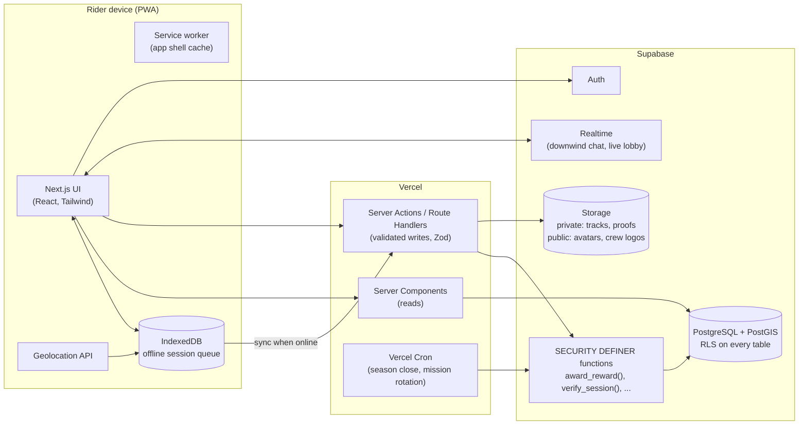
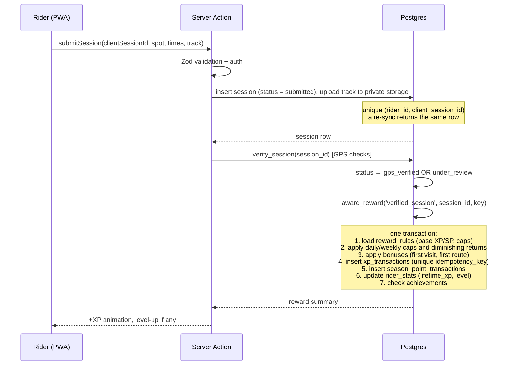

# 01 — Technical Architecture Proposal

**Status:** Proposal — awaiting approval
**Date:** 2026-11-14

Wind of Legend is a mobile-first PWA in which real kiteboarding activity
(sessions, downwinds, spot discoveries, community help) is verified and then
turned into progression: Lifetime XP, levels, achievements, Season Points and
league standings.

---

## 1. Guiding principles

1. **The server is the only authority on progression.** Clients _request_
   actions (submit a session, vote, join a downwind). Clients never send an
   XP amount and can never write to progression tables.
2. **One append-only ledger.** Every XP or Season Point change is a row in a
   ledger with a unique idempotency key. Totals are derived, cached and
   always rebuildable from the ledger.
3. **Private by default.** GPS tracks are visible to their owner only. Public
   surfaces show spot-level or region-level data, never live positions.
4. **Offline first for recording.** A session can be recorded with no
   network and synced later without ever producing a duplicate reward.
5. **Reward participation, not risk.** No reward input is based on speed,
   jump height or other risky metrics. Speed is used only to reject
   implausible tracks.
6. **Build in phases.** Each phase ships something usable and tested before
   the next one starts.

---

## 2. System overview



### Responsibilities

| Layer                   | Owns                                                                      | Never does                           |
| ----------------------- | ------------------------------------------------------------------------- | ------------------------------------ |
| Browser / PWA           | Rendering, offline GPS capture, optimistic UI                             | Computing XP, deciding verification  |
| Next.js server (Vercel) | Input validation (Zod), authorization checks, orchestration, file uploads | Holding secrets in client bundles    |
| Postgres functions      | Reward calculation, idempotency, caps, diminishing returns, level updates | Trusting any amount sent by a client |
| RLS policies            | Row visibility and ownership for direct reads                             | Replacing server-side business rules |

---

## 3. Stack decisions

| Concern         | Choice                                                 | Notes                                                            |
| --------------- | ------------------------------------------------------ | ---------------------------------------------------------------- |
| Framework       | **Next.js (App Router)** + React + TypeScript `strict` | Server Components for reads, Server Actions for writes           |
| Styling         | **Tailwind CSS** with design tokens as CSS variables   | Tokens in `src/styles/tokens.css`, mapped in Tailwind config     |
| Validation      | **Zod**                                                | One schema shared by forms and server actions                    |
| Database        | **Supabase Postgres** + **PostGIS**                    | PostGIS for spots, routes and proximity queries                  |
| Auth            | **Supabase Auth** via `@supabase/ssr`                  | Email magic link + Google at launch; Apple later                 |
| Storage         | Supabase Storage                                       | `tracks` and `proofs` private; `avatars` and `crew-logos` public |
| Realtime        | Supabase Realtime                                      | Downwind lobby and chat only (Phase 3+)                          |
| Offline         | Service worker + **IndexedDB** (`idb` library)         | Queue of unsynced sessions keyed by a client UUID                |
| Maps            | **Mapbox GL JS** (later), behind a `MapView` adapter   | Static spot lists until then                                     |
| Unit tests      | **Vitest**                                             | Pure game logic: curves, caps, scoring                           |
| DB tests        | **pgTAP** (`supabase test db`)                         | RLS and reward functions; needs Docker or a CI runner            |
| E2E tests       | **Playwright** (from Phase 3)                          | Critical flows only                                              |
| Hosting         | Vercel + Supabase (separate dev and prod projects)     | Preview deployments per pull request                             |
| CI              | GitHub Actions                                         | Lint, typecheck, unit tests, migration check                     |
| Package manager | **npm**                                                | Already installed; pnpm is not                                   |

---

## 4. Code organization (feature-based)

```
wind-of-legend/
├── docs/                         # This proposal, ADRs, roadmap
├── supabase/
│   ├── migrations/               # Timestamped SQL migrations (source of truth)
│   ├── seed.sql                  # Regions, spots, levels, reward rules, achievements
│   └── tests/                    # pgTAP tests (RLS + reward functions)
├── public/                       # PWA icons, manifest assets
├── src/
│   ├── app/                      # Routes only: thin, compose features
│   │   ├── (auth)/login/
│   │   ├── (app)/                # Authenticated shell with bottom nav
│   │   │   ├── home/
│   │   │   ├── explore/
│   │   │   ├── create/
│   │   │   ├── league/
│   │   │   └── profile/[username]/
│   │   ├── auth/callback/route.ts
│   │   ├── manifest.ts
│   │   └── layout.tsx
│   ├── features/                 # One folder per domain
│   │   ├── auth/
│   │   ├── profile/
│   │   ├── progression/          # XP, levels, achievements (Phase 2)
│   │   ├── sessions/             # Recording, offline sync, verification (Phase 3)
│   │   ├── downwinds/            # Events, participants, ride shares (Phase 3)
│   │   ├── missions/             # (Phase 4)
│   │   ├── crews/                # (Phase 4)
│   │   ├── leagues/              # Seasons, leaderboards (Phase 5)
│   │   └── geo/                  # Regions, spots, routes, MapView adapter
│   │       ├── components/       #   UI for this feature
│   │       ├── server/           #   server-only queries and actions ('server-only')
│   │       ├── lib/              #   pure logic (unit tested)
│   │       ├── schemas.ts        #   Zod schemas
│   │       └── types.ts
│   ├── components/
│   │   ├── ui/                   # Design system primitives (Button, Card, ...)
│   │   └── game/                 # Shared game visuals (XPBar, LevelBadge, ...)
│   ├── lib/
│   │   ├── supabase/             # browser.ts, server.ts, middleware.ts, admin.ts
│   │   ├── env.ts                # Zod-validated environment variables
│   │   └── utils.ts
│   ├── styles/tokens.css
│   └── types/database.ts         # Generated by `supabase gen types`
├── middleware.ts                 # Session refresh + route protection
├── .env.example                  # Names only, never values
└── .github/workflows/ci.yml
```

**Dependency rules**

- `app/` may import from `features/`, `components/` and `lib/`.
- A feature may import from `components/`, `lib/` and the **public
  `index.ts`** of another feature, never from its internals.
- Anything under `server/` starts with `import 'server-only'`.
- `lib/supabase/admin.ts` (service role) is used only for jobs like season
  settlement. Normal requests use the rider's own session so RLS applies.

---

## 5. Progression engine (core of the game)

### 5.1 The reward flow



### 5.2 Rules the engine guarantees

| Rule                                           | Mechanism                                                                                                                                                                                                     |
| ---------------------------------------------- | ------------------------------------------------------------------------------------------------------------------------------------------------------------------------------------------------------------- |
| XP awarded server-side only                    | No `insert/update` grants on ledger or stats tables for `authenticated`; writes only through `SECURITY DEFINER` functions                                                                                     |
| Every change is auditable                      | `xp_transactions` is append-only (trigger rejects `UPDATE` and `DELETE`); corrections are new negative rows of type `admin_adjustment` with a reason and actor                                                |
| No duplicate rewards                           | `idempotency_key` is `UNIQUE`; the function uses `INSERT ... ON CONFLICT DO NOTHING` and returns the existing result                                                                                          |
| No double base reward for a group downwind     | One **base** key per session (`session_base:{session_id}`); a downwind session earns downwind XP (100) _instead of_ session XP (50). The group bonus has its own key (`group_bonus:{downwind_id}:{rider_id}`) |
| Organizer XP only if the group really happened | `group_organize:{downwind_id}` is awarded once at least N other participants have verified sessions linked to the downwind                                                                                    |
| Caps and diminishing returns                   | `reward_rules` table (admin configurable): `daily_cap`, `weekly_cap`, `diminishing` array (for example `[1, 0.5, 0.25, 0]`)                                                                                   |
| Bonuses decided by the backend                 | First visit and first route are detected in SQL from the ledger, never passed in by the client                                                                                                                |
| Race conditions                                | Function runs in one transaction and takes `pg_advisory_xact_lock(hashtext(rider_id))`, so caps are counted correctly under concurrent syncs                                                                  |
| Lifetime XP never resets                       | `rider_stats.lifetime_xp` = sum of `xp_transactions`; no season logic touches it                                                                                                                              |
| Season Points reset                            | SP live in `season_point_transactions` keyed by `season_id`; a new season simply starts with no rows                                                                                                          |
| Regional and global rankings are independent   | Each SP row carries the `region_id` of the activity. Regional = sum filtered by region. Global = sum of all rows. Both come from the same ledger                                                              |
| No reward for dangerous behavior               | Speed, jump height and similar metrics are never inputs. Implausible speed (> 80 km/h sustained) sends the session to review instead                                                                          |

### 5.3 Season Points formula (initial)

`SP = 0.7 × activity_points + 0.2 × exploration_points + 0.1 × community_points`

Each SP ledger row has a `category` (`activity`, `exploration`, `community`).
The weights live in the `seasons` row (`sp_weights jsonb`), so they can be
tuned per season without code changes. Leaderboards read a materialized
`league_scores` table refreshed by the server after each award and fully
recomputed at season close.

### 5.4 Level curve

The documented milestones (1→0, 2→100, 3→250, 5→700, 10→2,000 … 50→100,000)
are fixed. Levels in between use **geometric interpolation** between the
neighbouring milestones, rounded to 10 XP. This gives a smooth, always
increasing curve. All 50 levels are seeded into `rider_levels`; the MVP
enables levels 1–10 (`is_enabled`). The same function lives in
`features/progression/lib/levels.ts` and is unit tested against the seed.

---

## 6. Sessions, offline and GPS privacy

- **Recording:** The PWA records GPS points into IndexedDB under a
  client-generated `client_session_id` (UUID v4). Nothing needs the network.
- **Sync:** When online, the queue uploads each session. The server upserts
  on `(rider_id, client_session_id)`, so retrying is always safe.
- **Track storage:** Raw tracks go to the private `tracks` storage bucket
  under `{rider_id}/{session_id}.json.gz`. Only derived metrics (duration,
  distance, start spot) are stored in `sessions`.
- **Checks (Phase 3):** minimum duration, plausible speed, start or end
  within an approved spot or route corridor, overlap with the rider's other
  sessions (duplicate detection), point density.
- **Consent:** GPS recording requires `rider_preferences.gps_consent = true`
  with a timestamp. Riders can delete tracks at any time. Derived metrics are
  kept, and the session keeps its verification status.
- **Community verification:** participants of the same downwind can confirm
  each other. Limits: one vote per voter per session, no self-votes, and at
  most 3 mutual confirmations between the same pair in 30 days (enforced in
  `cast_verification_vote()`).
- **Live location:** not stored, not published.

---

## 7. Security model

- **RLS enabled on every table**, with deny-by-default.
- **Column-level grants** on `profiles`: riders may update only their own
  display fields. `app_role` and all stats fields are not writable.
- **Roles:** `rider`, `moderator`, `admin` (in `profiles.app_role`).
  Moderators can review sessions and act on reports. Only admins can make
  XP adjustments. Every moderator or admin action writes `audit_logs`.
- **Secrets:** `.env.local` (git-ignored). `.env.example` lists names only.
  The service role key exists only in server environment variables and is
  never imported by client code (`server-only` guard + `env.ts` validation).
- **Rate limiting:** on server actions that create content (sessions, votes,
  reports).

---

## 8. Environments and local development

| Environment | Supabase                                                                     | Hosting               |
| ----------- | ---------------------------------------------------------------------------- | --------------------- |
| Local       | Hosted **dev** project (Docker is not installed, so no local Supabase stack) | `npm run dev`         |
| Preview     | Same dev project                                                             | Vercel preview per PR |
| Production  | Separate **prod** project                                                    | Vercel production     |

Migrations are applied with the Supabase CLI through `npx supabase`, so
nothing needs a global install. If Docker Desktop is installed later, the
project can switch to a fully local stack (`supabase start`) and run pgTAP
locally. Until then pgTAP runs in GitHub Actions.

---

## 9. Prerequisites on this machine

| Tool                           | Status       | Needed for                                  |
| ------------------------------ | ------------ | ------------------------------------------- |
| Node.js 24 / npm 11            | ✅ Installed | Everything                                  |
| Git (Xcode Command Line Tools) | ❌ Missing   | Version control, GitHub                     |
| GitHub account + repository    | ❓           | Hosting the code                            |
| Supabase account (dev project) | ❓           | Database, auth                              |
| Vercel account                 | ❓           | Deploy (can wait until Phase 1 is finished) |
| Docker Desktop                 | ❌ Optional  | Local Supabase and local pgTAP              |

---

## 10. Open questions for approval

1. **Final name:** "Wind of Legend" (used in this proposal). The design
   document also says "Wind of Leguends", "Wind of Léguend" and "Windmates".
2. **Login methods at launch:** email magic link + Google?
3. **One crew per rider** (simpler, fairer crew competition) or several?
4. **App languages:** Portuguese (Preá riders), English, Spanish? i18n is
   cheap to set up in Phase 1 and expensive to add later.
5. **Brand assets:** exact colors, fonts or a logo, or should Phase 1 propose
   them from the visual direction?
