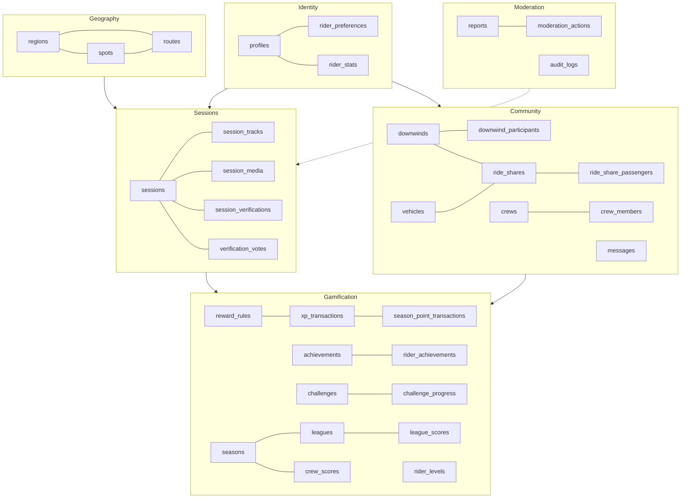
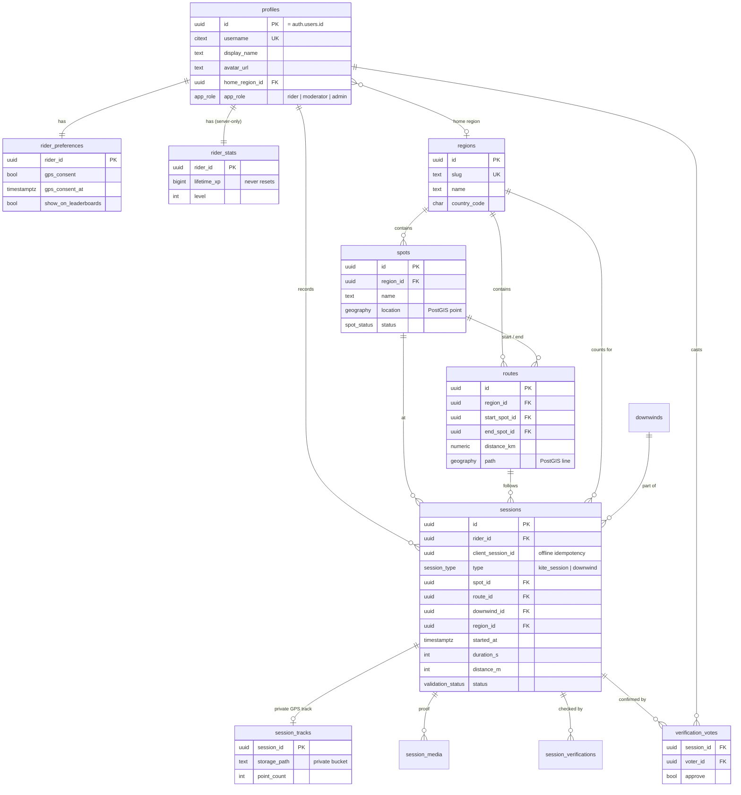
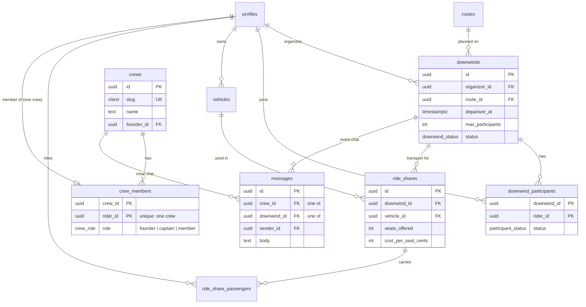
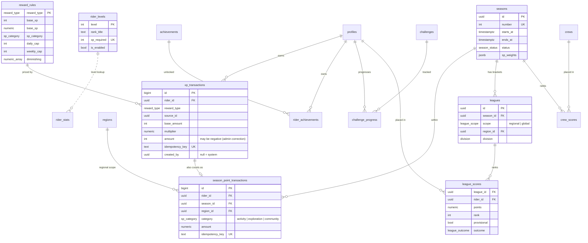

# 02 — Database Entity Relationship Diagram

**Status:** Proposal — awaiting approval

The schema is split into six domains. The full DDL is in
[03-initial-schema.sql](03-initial-schema.sql). GitHub renders the Mermaid
diagrams below automatically.

---

## Overview by domain

---

## Identity, geography and sessions

---

## Community

---

## Gamification and competition

---

## Key constraints at a glance

| Constraint                                                        | Purpose                               |
| ----------------------------------------------------------------- | ------------------------------------- |
| `xp_transactions.idempotency_key UNIQUE`                          | No duplicate XP                       |
| `season_point_transactions.idempotency_key UNIQUE`                | No duplicate SP                       |
| `sessions (rider_id, client_session_id) UNIQUE`                   | Offline re-sync is safe               |
| `verification_votes (session_id, voter_id) PK`                    | One vote per voter                    |
| `crew_members.rider_id UNIQUE`                                    | One crew per rider (pending approval) |
| `seasons` exclusion constraint on `tstzrange(starts_at, ends_at)` | Seasons never overlap                 |
| `league_scores (league_id, rider_id) PK`                          | One placement per bracket             |
| Trigger on `xp_transactions` and `season_point_transactions`      | Append-only ledger                    |
