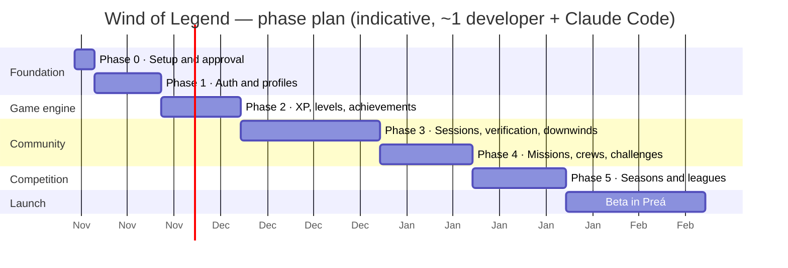

# 04 — Development Roadmap

**Status:** Proposal — awaiting approval

Each phase ends with a **gate**: working software on a preview deployment,
passing tests, and your approval before the next phase starts. Every phase is
delivered as one or more pull requests on GitHub.

Durations are rough estimates to show order and relative size, not commitments.

---

## Phase 0 — Setup and approval (current)

- [x] Technical architecture proposal
- [x] Entity relationship diagram
- [x] Initial database schema
- [x] Development roadmap
- [x] UI component architecture
- [x] **Your approval**
- [ ] Answers to the open questions (defaults applied, see ADR 0007)
- [x] Install Git (Xcode Command Line Tools)
- [ ] Create the GitHub repository and a Supabase dev project

## Phase 1 — Foundation

**Goal:** a rider can sign up, log in, choose a username and see their profile.

1. Next.js (App Router) + TypeScript `strict` + ESLint + Prettier
2. Tailwind with Wind of Legend design tokens (ocean navy, turquoise, cyan, gold)
3. Design system primitives: `Button`, `Card`, `Input`, `Avatar`, `Badge`, `Sheet`, `Toast`
4. App shell: mobile bottom navigation (Home, Explore, Create, League, Profile)
5. Supabase clients (`@supabase/ssr`) + `env.ts` validation + `.env.example`
6. Migrations: extensions, enums, geography, identity tables, RLS, signup trigger
7. Seed: Ceará region, first Preá-area spots and routes, levels, reward rules
8. Auth: email magic link (+ Google if approved), callback, middleware protection
9. Onboarding: username, display name, home spot, GPS consent explanation
10. Profile page (own + public), edit profile, avatar upload
11. PWA manifest and installable app shell
12. GitHub Actions CI: lint, typecheck, unit tests, build
13. ADRs for each major decision

**Gate:** sign up → onboarding → profile works on a Vercel preview; RLS tests
show a rider cannot edit another profile or their own role.

**Status (2026-11-14):** code complete on branch `phase-1/foundation`. Lint,
typecheck, 53 unit tests and the production build pass. Still open for the
gate: linking a Supabase dev project, applying the migration, running the
pgTAP tests and testing sign-up end to end. Changes from the plan:
`Sheet` and `Toast` move to Phase 2, where rewards need them; the
`rider_levels` and `reward_rules` seeds move to Phase 2 with their tables;
the middleware is `src/proxy.ts` (Next.js 16 renamed it).

## Phase 2 — Game engine

**Goal:** a trusted, tested XP economy (driven by test fixtures until sessions exist).

1. `xp_transactions` and `season_point_transactions` ledgers + append-only triggers
2. `award_reward()`: idempotency, caps, diminishing returns, bonuses, advisory lock
3. `level_for_xp()` + `rider_stats` updates + level-up events
4. Achievements catalogue + `evaluate_achievements()`
5. `admin_adjust_xp()` with audit log
6. UI: `XPBar`, `LevelBadge`, level-up celebration, achievements grid, XP history
7. **Tests:** Vitest for curve/caps/scoring logic; pgTAP for idempotency,
   concurrent awards, cap enforcement and RLS denial of direct writes

**Gate:** calling the same reward twice gives XP once; 10 concurrent calls
respect caps; clients cannot insert XP.

## Phase 3 — Sessions, verification and downwinds

**Goal:** real sessions earn XP; riders organize downwinds together.

1. Session recorder with GPS consent, IndexedDB queue and background sync
2. Track upload to private storage; derived metrics; duplicate detection
3. `verify_session()` plausibility checks → `gps_verified` / `under_review`
4. Community verification with anti-collusion limits
5. Manual session entry with optional photo proof
6. Downwinds: create, join, leave, participant list, status lifecycle
7. Ride sharing: vehicles, seats, cost split, passenger requests
8. Downwind chat (Realtime)
9. Spot discovery and route publishing (moderated)
10. Moderator review queue
11. Playwright E2E: record offline → sync → verified → XP

**Gate:** a group downwind in Preá goes end to end without duplicate rewards.

## Phase 4 — Missions, crews and challenges

1. Admin-configurable daily, weekly and adventure missions
2. Mission progress engine fed by verified activity
3. Crews: create, invite, roles, crew profile and logo, crew chat
4. Crew XP with weekly per-member caps; shared crew missions
5. Home screen: daily missions, nearby downwinds, recommended crews, activity feed

## Phase 5 — Seasons and leagues

1. Season lifecycle (announce → active → final 48 h → close → settle) via Vercel Cron
2. Regional and global leaderboards from the SP ledger
3. Divisions, provisional placement for new riders, promotion and relegation
4. Season rewards (titles, frames, seasonal achievements), previous-season results
5. Crew competition scoring that rewards cooperation, not crew size

## Launch — Beta in Preá

- Mapbox integration (Explore map, routes, spots)
- Fraud and load testing on the reward engine
- Privacy review (GPS consent, deletion, LGPD)
- Closed beta with Preá riders, feedback loop, metrics dashboard
  (Weekly Verified Active Riders)

## After the beta

- Full 50-level progression and cosmetic unlocks
- Automated GPS analysis improvements
- Device integrations (watches, kite trackers)
- New regions: Rio Grande do Norte, Bahia, Santa Catarina, international

---

## MVP coverage check

| MVP item (design doc §15)           | Phase                  |
| ----------------------------------- | ---------------------- |
| Registration and login              | 1                      |
| Rider profiles                      | 1                      |
| Lifetime XP                         | 2                      |
| 10 initial levels                   | 2                      |
| Session registration                | 3                      |
| GPS or community verification       | 3                      |
| Downwind creation and participation | 3                      |
| Daily and weekly missions           | 4                      |
| Achievements                        | 2                      |
| Basic crews                         | 4                      |
| Regional leaderboard                | 5                      |
| Global leaderboard                  | 5                      |
| PWA installation                    | 1 (shell), 3 (offline) |
