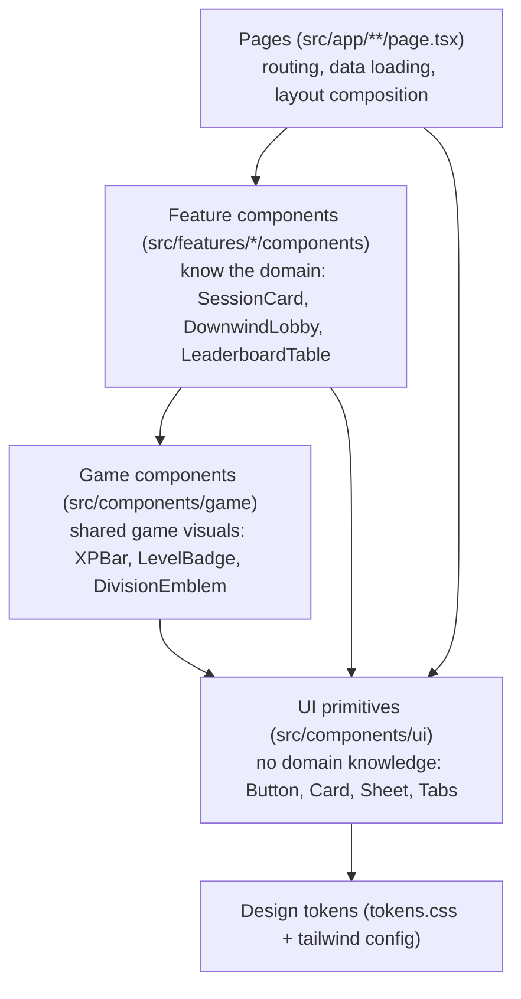
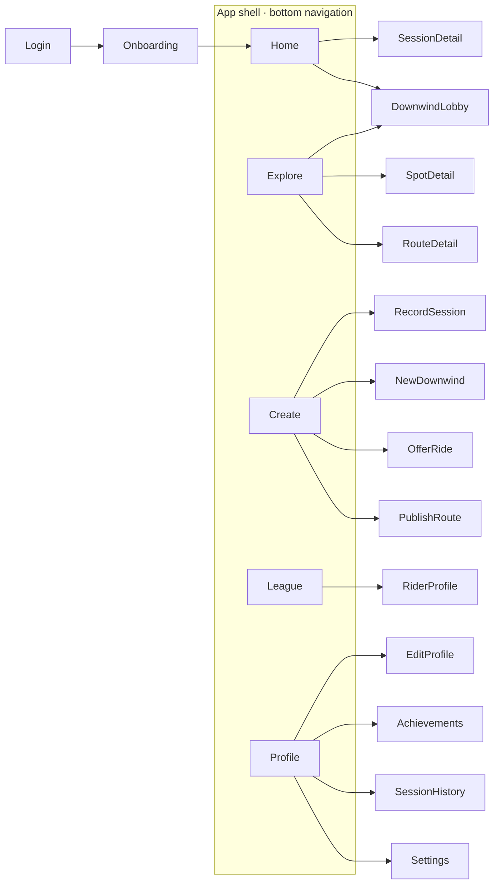

# 05 — UI Component Architecture

**Status:** Proposal — awaiting approval

Mobile-first, premium outdoor sports + adventure gaming. The interface should
feel calm and confident: dark ocean surfaces, clear data, and gold used
sparingly for real achievements. It must never feel like a casino or a
betting app.

---

## 1. Design tokens (proposal)

Tokens are CSS variables in `src/styles/tokens.css`, mapped into Tailwind so
components never use raw hex values. These are proposed values to be replaced
if you have official brand colors.

| Token               | Value     | Use                                  |
| ------------------- | --------- | ------------------------------------ |
| `--color-abyss`     | `#06121F` | App background                       |
| `--color-deep`      | `#0B1E33` | Cards, sheets                        |
| `--color-swell`     | `#13304D` | Raised surfaces, inputs              |
| `--color-foam`      | `#E8F4F8` | Primary text                         |
| `--color-mist`      | `#8FA9BF` | Secondary text                       |
| `--color-turquoise` | `#1FC8B5` | Primary actions, progress            |
| `--color-cyan`      | `#22D3EE` | Highlights, focus rings, live state  |
| `--color-gold`      | `#F2B84B` | Achievements, level-ups, podium only |
| `--color-coral`     | `#FF6B5E` | Errors, destructive actions          |
| `--color-sand`      | `#E9D8B4` | Rare accent (exploration, maps)      |

- **Typography:** `Inter` for UI and numbers (tabular figures for
  leaderboards), `Space Grotesk` for display headings. Both are open-source
  Google fonts, loaded with `next/font`.
- **Radius:** 12 px cards, 999 px pills. **Spacing:** 4 px scale.
- **Motion:** 150–300 ms ease-out; the XP bar fills and level-ups use a
  short gold shimmer. All motion respects `prefers-reduced-motion`.
- **Contrast:** text on surfaces at WCAG AA or better. Gold is never used
  for body text.

---

## 2. Layers



**Rules**

- Primitives and game components receive data via props. They never fetch
  and never import Supabase.
- Feature components may be Server Components (reads) or Client Components
  that call Server Actions (writes). Client components are kept small and at
  the leaves of the tree.
- Every component that shows a number from progression (XP, SP, rank) gets it
  from the server. The UI never computes rewards; it only animates a server
  result.

---

## 3. Component inventory

### UI primitives — `src/components/ui`

| Component                                           | Notes                                                                         |
| --------------------------------------------------- | ----------------------------------------------------------------------------- |
| `Button`                                            | Variants: primary (turquoise), secondary, ghost, danger; sizes; loading state |
| `IconButton`                                        | 44 px minimum touch target                                                    |
| `Card`                                              | Surface with optional header, footer and `interactive` state                  |
| `Input`, `Textarea`, `Select`, `Switch`, `Checkbox` | Integrated with Zod errors                                                    |
| `FormField`                                         | Label + control + hint + error                                                |
| `Avatar`, `AvatarStack`                             | Image fallback to initials                                                    |
| `Badge`, `Pill`                                     | Status, counts, tags                                                          |
| `Tabs`, `SegmentedControl`                          | Regional/Global switch, history filters                                       |
| `Sheet` (bottom sheet), `Dialog`                    | Mobile-first modals                                                           |
| `Toast`                                             | Reward and error feedback                                                     |
| `ProgressBar`                                       | Generic progress                                                              |
| `Skeleton`, `EmptyState`, `ErrorState`              | Loading and empty screens                                                     |
| `Stat`                                              | Label + value + optional delta                                                |
| `List`, `ListItem`                                  | Dense mobile lists                                                            |

### Game components — `src/components/game`

| Component            | Shows                                                         |
| -------------------- | ------------------------------------------------------------- |
| `XPBar`              | Progress to next level, animated fill after a reward          |
| `LevelBadge`         | Level number + rank title (for example "10 · Adventurer")     |
| `RewardToast`        | "+100 XP · Verified downwind" with breakdown of bonuses       |
| `LevelUpCelebration` | Full-screen moment with the new rank and unlocks (gold)       |
| `AchievementTile`    | Locked / unlocked achievement with progress hint              |
| `DivisionEmblem`     | Bronze → Legend emblem                                        |
| `RankChange`         | ▲ / ▼ / – movement indicator                                  |
| `SeasonCountdown`    | Days left, highlights the final 48 h window                   |
| `VerificationBadge`  | Draft / Submitted / Under review / GPS / Community / Rejected |
| `MissionCard`        | Mission, progress, reward, cadence                            |
| `StreakIndicator`    | Active days without punishing rest days                       |

### Feature components — `src/features/*/components`

| Feature       | Components                                                                                                                           |
| ------------- | ------------------------------------------------------------------------------------------------------------------------------------ |
| `auth`        | `LoginForm`, `MagicLinkSent`, `OAuthButtons`                                                                                         |
| `profile`     | `ProfileHeader`, `ProfileStats`, `EditProfileForm`, `OnboardingFlow`, `GpsConsentCard`                                               |
| `progression` | `XPHistoryList`, `AchievementsGrid`, `LevelRoadmap`                                                                                  |
| `sessions`    | `SessionRecorder`, `OfflineQueueBanner`, `SessionForm`, `SessionCard`, `SessionHistory`, `VerifyRequestCard`                         |
| `downwinds`   | `DownwindCard`, `DownwindForm`, `DownwindLobby`, `ParticipantList`, `RideShareCard`, `RideShareForm`, `SafetyNotice`, `DownwindChat` |
| `missions`    | `DailyMissions`, `WeeklyMissions`, `AdventureMap`                                                                                    |
| `crews`       | `CrewCard`, `CrewProfile`, `CrewMemberList`, `CrewInviteSheet`, `CrewChat`                                                           |
| `leagues`     | `LeaderboardTable`, `LeaderboardRow`, `DivisionStatus`, `SeasonHeader`, `PastSeasons`                                                |
| `geo`         | `SpotCard`, `RouteCard`, `SpotPicker`, `MapView` (adapter: static list now, Mapbox later)                                            |

---

## 4. Screens



| Tab         | Composition (top → bottom)                                                                                                                         |
| ----------- | -------------------------------------------------------------------------------------------------------------------------------------------------- |
| **Home**    | Greeting + `LevelBadge` + `XPBar` · `DailyMissions` · nearby `DownwindCard`s · recommended `CrewCard`s · community activity                        |
| **Explore** | `SegmentedControl` (Spots / Routes / Downwinds / Rides) · `MapView` · results list                                                                 |
| **Create**  | Large action tiles: Record session · Create downwind · Offer ride · Publish route · Crew challenge                                                 |
| **League**  | `SeasonHeader` + `SeasonCountdown` · `DivisionStatus` · `Tabs` (Regional / Global) · `LeaderboardTable` (own row pinned) · `PastSeasons`           |
| **Profile** | `ProfileHeader` · `ProfileStats` (Lifetime XP, regional and global rank) · `AchievementsGrid` preview · discovered spots · crew · `SessionHistory` |

### Example wireframe — Home (mobile)

```
┌─────────────────────────────┐
│ Bom vento, Rider 🌊         │
│ [10 · Adventurer]           │
│ ████████████░░░░  1,640/2,000 XP
├─────────────────────────────┤
│ Today's missions            │
│ ◻ Register a session  +50   │
│ ◼ Join a group ride   +80 ✓ │
├─────────────────────────────┤
│ Downwinds near you          │
│ ┌ Preá → Guriú · 13:30 ─────┐│
│ │ 6/10 riders · 2 seats     ││
│ └───────────────────────────┘│
├─────────────────────────────┤
│ Crews · Activity            │
├─────────────────────────────┤
│ 🏠   🧭   ＋   🏆   👤       │
└─────────────────────────────┘
```

---

## 5. State and data flow

| Data                                           | Where it lives                                             | How it updates                                                |
| ---------------------------------------------- | ---------------------------------------------------------- | ------------------------------------------------------------- |
| Server data (profile, leaderboards, downwinds) | Server Components, fetched per request                     | `revalidatePath` / `revalidateTag` after Server Actions       |
| Mutations                                      | Server Actions with Zod validation                         | Return a typed result (`ok` / `error`) and the reward summary |
| Offline sessions                               | IndexedDB queue (`features/sessions/lib/offline-queue.ts`) | Synced by `useSyncQueue` when online                          |
| Live chat and lobby                            | Supabase Realtime in client components                     | Subscriptions scoped to one downwind or crew                  |
| UI-only state                                  | Local React state                                          | —                                                             |

No global client store is planned. Server Components + Server Actions +
Realtime cover the needs without one.

---

## 6. Accessibility and i18n

- Minimum touch target of 44 px, visible focus rings (cyan), semantic HTML.
- Leaderboards are real tables with screen-reader labels for rank changes.
- Celebrations can be skipped and respect reduced motion.
- Text goes through an i18n layer from Phase 1 (proposal: `next-intl`), with
  Portuguese (Brazil) as the default and English and Spanish next. This is
  pending your answer on languages.
